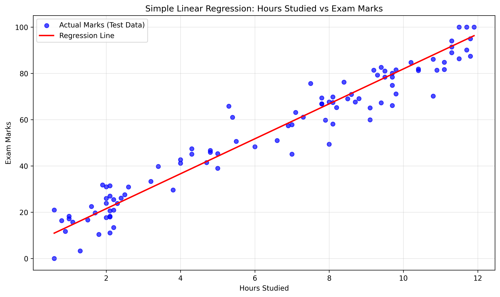

# Simple Linear Regression

## About the Project
This is my first machine learning project.
It predicts exam marks based on hours studied
using Simple Linear Regression.

## Technologies Used
- Python
- Pandas
- NumPy
- Matplotlib
- Scikit-learn

## Project Features
- Load the dataset
- Split data into training and testing sets
- Train a Linear Regression model
- Predict marks for a new student
- Calculate MAE, MSE, RMSE, and R²
- Plot actual marks and the regression line

## Dataset
The dataset contains two columns:
- Hours_Studied
- Exam_Marks

If the data is generated for practice, it is synthetic.

## How to Run
Install the libraries:

pip install pandas numpy matplotlib scikit-learn

Run the Python file:

python linear_regression.py

## Regression Plot

